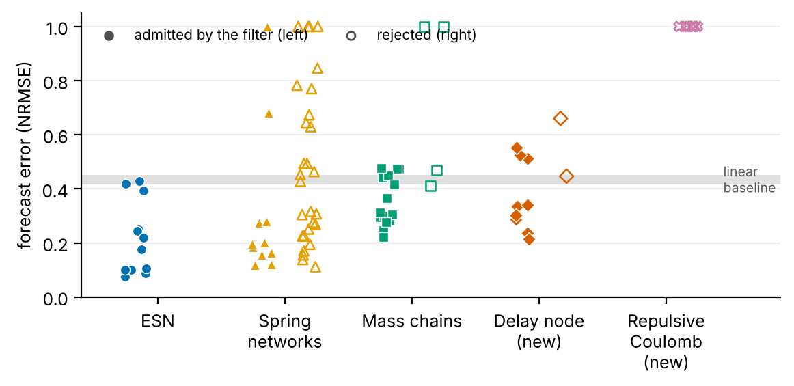

# Can the equations of a physical reservoir predict its computing capacity?

> [!WARNING]
> **Work in progress — not peer reviewed.**
> These are early, exploratory results. All systems are **simulated**, a **single forecasting task** is used, and the methods and numbers have **not been checked by anyone outside the project**. Errors have already been found and corrected along the way (they are documented), and others may remain. Please treat everything here as working hypotheses, not established results, and do not cite it as such. Criticism, replications and bug reports are very welcome.

## In short

In **physical reservoir computing** (PRC), a piece of matter or a mechanism transforms an input signal through its own dynamics, and only a linear readout is trained. The laws of the substrate are given, not chosen, so finding a good substrate usually means building it, driving it and measuring.

This project asks whether part of that selection can be done **on paper, from the equations alone**, before the system is ever driven or trained. The test task is forecasting the chaotic Mackey–Glass series 10 and 20 steps ahead, a task that a linear model cannot solve.

📄 **Short report (5 pages): [`report/short_report.pdf`](report/short_report.pdf)**

## Main results so far

| | Result | Status |
|---|---|---|
| ✅ | A filter of **four necessary conditions**, computed from the undriven equations, separates systems that can forecast from those that cannot. On 90 systems never seen before: median error **0.28** (admitted) vs **0.56** (rejected); 17 of the 22 best systems admitted. | confirmed three times, on 21, 33 and 90 systems |
| ✅ | The filter's verdicts held on **two families of substrates never used** to build it (single delay node, repulsive Coulomb charges). | confirmed |
| ✅ | The **memory capacity** of a nearly linear system can be **computed from its linearised equations**, with no fitted parameter (median deviation 4 %). Non-linearity only lowers it. | criterion met, 5 of 5 systems |
| ✅ | A system that passes the filter but is **linear at its operating point** forecasts no better than a linear model. | criterion met, 6 of 6 systems |
| 🟡 | Inside one family (40 new spring networks with identical equations), the memory capacity computed from the equations **ranks** the networks by forecast error (rank correlation −0.59). | met, but a ranking only (R² = 0.09) |
| ❌ | A "richer" or more complex dynamics computes better: the **first hypothesis** of the project. | not supported |
| ❌ | A graded version of the "single final state" condition does better than the yes/no version. | failed |
| ❌ | A predictor of the error built on these descriptors works on a family it has never seen. | failed (delay node) |

Five of the seven criteria written **before** the final confirmation run are met; the two others are reported as failures. Details: [short report](report/short_report.pdf), Table 1.

<p align="center">
  
</p>

## How the idea evolved

The project did not end where it started. It began with the hypothesis that **the complexity of a system's dynamics** (measured by an eight-axis "complexity vector") predicts its computing capacity across substrates. That hypothesis failed for clear reasons, and those reasons pointed to something else: **the structure of the equations** (symmetries, equilibria, dissipation, linearised spectrum, non-linearity at the operating point).

➡️ **[docs/how_the_idea_evolved.md](docs/how_the_idea_evolved.md)** explains this pivot step by step: what was tried, why it failed, what was kept and what was dropped.

## The structural filter

Computed **without any time-varying input**. The system is relaxed to rest and the Jacobian of one step is computed by finite differences.

| | Condition | Typical failure it catches |
|---|---|---|
| Q1 | No neutral mode (all eigenvalues of the step Jacobian strictly inside the unit circle) | isotropic Coulomb cloud (free rotation), free chain (free translation) |
| Q2 | The system returns to the same state from six random starts | double-well chain, mixed-sign Coulomb charges, many spring networks |
| Q3 | The input acts on the state | — |
| Q4 | The readout sees the state | — |

These are **necessary** conditions for the echo state property (also called fading memory, convergent dynamics or incremental stability): a system that forgets its initial state for every input must forget it for zero input. They are local and numerical, and not sufficient.

## Repository layout

```
README.md
docs/how_the_idea_evolved.md   the pivot of the project, explained
report/short_report.pdf        5-page report (source: short_report.tex)
report/make_figures.py         redraws the report figures from data/
src/                           the code: 18 files = 18 notebook cells (steps 1 to 17)
notebook/                      the same code as a ready-to-run Jupyter notebook
run_all.py                     runs all the cells from the command line
data/                          saved results of the long runs (steps 14, 16, 17)
figures/                       figures produced by the code
tools/build_notebook.py        regenerates the notebook from src/
```

## Getting started

Requires Python ≥ 3.10, NumPy and Matplotlib.

```bash
pip install -r requirements.txt

# re-analyse the saved runs (1 second): prints criteria P2 to P5
python run_all.py --quiet --then "e = load_rows('data/exploration.jsonl'); explore_analysis(e, show=False); c = load_rows('data/confirmation.jsonl'); confirm2_analysis(e, c, show=False)"

# run the debugging milestones of one step
python run_all.py --only structure

# run every milestone of every step (about 16 min on a laptop; 71 milestones, all [OK])
python run_all.py
```

Or open [`notebook/reservoir_structure.ipynb`](notebook/reservoir_structure.ipynb) in VS Code or Jupyter and run the cells in order.

**Why no imports between files?** The code was written as notebook cells: each file uses functions defined by the files before it, and the order matters. `run_all.py` and the notebook both reproduce this by executing the files in one shared namespace. Every file prints debugging **milestones** (`[OK]` / `[FAIL]`) when it runs.

> [!NOTE]
> Code comments, docstrings, console messages and the labels of the figures produced by the code are currently **in French** (only the `figures/short_*.png` used by the short report are in English). Family names inside `data/*.jsonl` are French too (`Ressorts` = spring networks, `Chaîne` = mass chain, `Retard` = delay node, `Coulomb répulsif` = repulsive Coulomb).

## The steps

| Step | File | Content | Milestones |
|---|---|---|---|
| 1 | `complexity_vector.py` | complexity vector (8 axes) | M1–M9 |
| 2a | `reservoir.py` | leaky ESN, two-copy protocol | R1–R5 |
| 3 | `substrates.py` | common substrate interface, technical check | S1–S5 |
| 4 | `vector_space.py` | fixed normalisation, parallel coordinates | N1–N5 |
| 5 | `sweep.py` | benchmark (memory capacity, NARMA-10), ESN sweep | W0–W4 |
| 6 | `coulomb.py` | charges in a harmonic well | C1–C7 |
| 7 | `cross.py` | transfer test ESN → Coulomb (failed) | X1–X4 |
| 8 | `bench_check.py` | check of the corrected benchmark | B1–B6 |
| 9 | `massspring.py` | mass-spring networks | K1–K8 |
| 10 | `geometry.py` | geometries as hidden parameters | G1–G3 |
| 11 | `forecast.py` | forecasting benchmark, linear-solvability rule | F1–F5 |
| 12 | `structure.py` | structural filter Q1–Q4 | Z1–Z5 |
| 13 | `confirm.py` | mass chains, first confirmation of the filter | H1–H3 |
| 14 | `linear_mc.py` | memory capacity from the linearisation | T1–T6 |
| 15 | `features.py` | graded structural profile, two new substrates | U1–U5 |
| 16 | `explore.py` | exploration on already-seen systems | E1–E3 |
| 17 | `confirm2.py` | confirmation on 90 unseen systems | V1–V3 |
| 2b | `live_time.py` | live display (run last, needs `%matplotlib widget`) | L1–L6 |

## How the results were obtained

- **One fixed task**, chosen by a rule set in advance: a linear autoregressive model must fail and a non-linear one succeed. Mackey–Glass at 10 and 20 steps passes; Mackey–Glass at 1 step and the Lorenz series at every horizon do not, and were not used.
- **An honest benchmark:** the readout is trained on one simulation and tested on another that starts from a different state and receives a different input. A single-trajectory benchmark had made a system that never forgets its initial state look excellent (memory capacity 12.9 instead of 0.2).
- **Exploration and confirmation are separate.** Thresholds and models were chosen on 64 systems already seen, then frozen. They were tested on 90 new systems, with hypotheses and numerical criteria written in the code before the first confirmation system was run.
- **Deviations are recorded.** One hypothesis (P3a) was replaced after the exploration and before the confirmation; one protocol change (longer runs for measuring memory capacity) was made before the corresponding test was run. Both are written in the code and in the report.

## Known limitations

- Simulated substrates only; real devices add noise, drift and physics that is not modelled.
- One task. The 40 spring networks of the final test share one operating point.
- Some criteria rest on few systems (5 and 6).
- "Structural analysis" is a loose name: the filter is really a local stability and basin-of-attraction analysis.
- A focused literature search did not find this filter applied across varied physical substrates with confirmation on unseen systems, but that search was not exhaustive.

## Acknowledgements

The Coulomb-charge substrate follows the equations and parameter values of [lele394/N-Body-electromagnetic-reservoir-computer](https://github.com/lele394/N-Body-electromagnetic-reservoir-computer); the code here is a rewrite with a time-varying input.

The code and the texts were developed with the help of an AI assistant (Claude, by Anthropic). Every number and figure comes from code that was actually executed, and the debugging milestones are there so anyone can check.

## License

[MIT](LICENSE) © 2026 Niels Faucher
