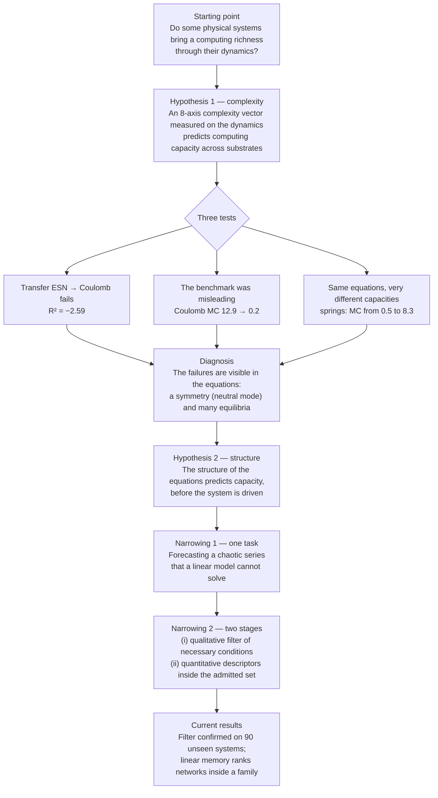

# How the idea evolved

> [!WARNING]
> Work in progress, not peer reviewed. This page explains the reasoning; the numbers are those of the code in `src/` and may change if errors are found.

This project changed direction once, deeply, and then narrowed in two steps. This page explains why, because the pivot is itself one of the results: the first idea failed in a way that showed where to look next.

## 1. The starting point

Reservoir computing has an unusual property: the dynamics is a **law**, not a parameter. In a trained recurrent network the dynamics is shaped by gradient descent to fit the data; in a reservoir, and above all in a physical one, it exists before any data and is left untouched. Only the readout learns.

The initial motivation was to show that **some physical systems bring a richness through their dynamics** that would be hard to reproduce without taking inspiration from them. Since any fading-memory filter can be approximated by a large enough echo state network, the defensible version is not "impossible to reproduce" but "reproducible only at a high cost". To compare dynamics at all, one first needs a **scale**: a way to say that one dynamics is richer than another.

## 2. Hypothesis 1: complexity of the dynamics

One number cannot be enough, because a memory-hungry task and a non-linearity-hungry task do not need the same kind of complexity. So we built a **complexity vector** with eight axes, measured on the states of a driven reservoir:

| Axis | What it measures |
|---|---|
| permutation entropy | how unpredictable the order patterns are |
| statistical complexity (Jensen–Shannon) | structure: low for pure order and pure noise, high in between |
| participation ratio | how many independent directions the state uses |
| neural complexity (Tononi) | balance between segregation and integration of channels |
| relaxation time (median and spread) | how long the system remembers |
| conditional Lyapunov exponent | whether two copies driven by the same input converge |
| consistency | whether genuinely different starts give the same response |

The hypothesis: **the vector predicts the capacity profile across substrates**. The success criterion was demanding on purpose: learn the map from vector to performance on one substrate, then predict another substrate that was never tuned. This is something hyperparameter tuning cannot do, since a spectral radius has no meaning for a magnetic film or a spring network.

## 3. Why it failed

**Test 1: transfer.** The map learned on 72 echo state networks predicted 72 Coulomb-charge reservoirs worse than guessing the mean (R² = −2.59). The two substrates occupied different regions of the vector space: only 3 of the 72 Coulomb systems fell in the range covered by the ESNs, and 40 of them were chaotic.

**Test 2: the benchmark itself was wrong.** Investigating the failure revealed a deeper problem. The readout was trained and tested on the same trajectory. Restarted from a really different state, the ESN responds identically (correlation 1.000), but the Coulomb system does not (correlation between −0.04 and 0.35): **it never forgets where it started**. The old benchmark gave it a memory capacity of 12.9, higher than the ESN; the corrected benchmark, with a readout tested on a different start and a different input, gives 0.2. The readout had learned a trajectory, not a function of the input. The conditional Lyapunov exponent could not see this, because it only tests infinitesimal perturbations.

**Test 3: same equations, different capacities.** Comparing two physical substrates with each other (mass–spring networks vs Coulomb charges, as originally intended, rather than a physical system vs an ESN) gave the most telling result. Twelve spring networks obey **identical equations** and differ only by their random geometry; their memory capacity ranges from **0.5 to 8.3**. The operating point we can tune explains 4 % of that variance. Adding a cubic non-linearity to the springs changes nothing measurable. Predicting a held-out geometry from the others failed with every predictor (R² ≤ 0.2).

So the algebraic complexity of the equations does not predict performance, and the substrate with the "richest" equations (Coulomb) is the worst.

## 4. The diagnosis: it is in the equations, but not as complexity

The causes of the Coulomb failure can be read directly in its equations:

- an **isotropic well** makes the whole system invariant under rotation. The linearised step has an eigenvalue of modulus exactly 1, and its eigenvector is the rigid rotation of the cloud. Nothing pulls the system back along that direction, so it can never forget its orientation;
- **charges of mixed signs** create many stable arrangements, so different starts end in different states.

Applying the textbook criteria for classifying equations (nature, linearity, order, dimension, symmetries) to the two physical substrates makes the point: nature, linearity and dimension are the same for both; only the **rank of the linearisation** and the **symmetries** differ, and those are exactly the two features the failure analysis had pointed to.

## 5. Hypothesis 2: the structure of the equations

> **The structure of a system's equations — symmetries, dissipation, equilibria, linearised spectrum, non-linearity at the operating point — predicts its computing capacity, before the system is driven.**

What changed:

| | Hypothesis 1 | Hypothesis 2 |
|---|---|---|
| What is analysed | data: the trajectory of the driven system | the equations: the undriven system, a small perturbation, a constant push |
| What is expected to matter | richness, complexity | specific structural features |
| Scope | all tasks, all substrates, one scale | one task at a time |

What was kept from the first phase: the corrected benchmark, the consistency axis, and the substrate "factory" (a common interface for ESNs, spring networks, chains, charges, delay nodes). What was dropped: the claim that a single complexity scale works across substrates. It was not refuted in its general form, since the transfer test compared two disjoint clouds with a faulty benchmark, but it received no support.

## 6. Narrowing 1: one task, chosen so that it cannot be solved linearly

A survey of existing physical reservoirs (water buckets, soft bodies, origami, spintronic devices, delay-based photonics) showed that **some substrates suit some tasks**. Multistability, for instance, destroys consistency, yet some works use it on purpose as a memory that does not fade. The question "is this a good reservoir?" only makes sense for a given task.

We fixed **forecasting a chaotic series**, and added a rule learned the hard way with a climate index (ENSO), where part of the problem turned out to be linear: for each candidate task, first measure a linear model, and **keep only the settings where it fails**. Mackey–Glass at 10 and 20 steps passes (linear model 0.42 and 0.45, ESN 0.10 and 0.085). At one step, the linear model already reaches 0.024, so a reservoir that succeeds there proves nothing.

## 7. Narrowing 2: a filter first, then quantities

The analysis was split in two stages, which must not use the same criteria, or the answer would be partly decided in advance:

1. **A qualitative filter** of four necessary conditions (no neutral mode, a single rest state, the input reaches the state, the readout sees it). These are classical ingredients (linear stability analysis, basins of attraction, controllability and observability) assembled into necessary conditions for the echo state property.
2. **Quantitative descriptors** to explain the differences among the admitted systems: memory capacity computed from the linearisation, static non-linearity at the operating point, and a graded version of the single-state condition.

## 8. Where it stands

- The filter separates systems that can forecast from those that cannot, on three successive sets (21, 33 and 90 systems), the last one including two families never used to build it.
- Two necessary conditions are now clear for this task: **forgetting the initial state** (the filter) and **being non-linear at the operating point** (a linear system that passes the filter does no better than a linear model).
- Inside a family, the **memory capacity computed from the equations ranks** the members, which the complexity vector could not do. It ranks; it does not predict precisely.
- What remains out of reach is a precise prediction of the error, especially for a family never seen before.

This is the honest state of the work: a filter that seems to hold, two quantities that help, and several failures that are reported as failures. All of it needs independent checking.
